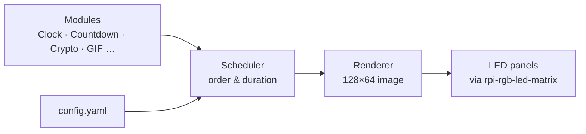

**English** | [Deutsch](/docs/README.de.md)

<div align="center">

# ✦ Waveshare P2.5 LED Matrix

**A modular display system for HUB75 LED panels on the Raspberry Pi.**
Build your own modules – clocks, countdowns, crypto tickers, animations – and let them run seamlessly one after another.


</div>

---

## Idea

Not a single script, but a small platform: the system takes care of hardware,
timing and playback. You only write **modules** that define *what* is shown.

## Architecture



## Modules

| Module | Description | Status |
|--------|-------------|--------|
| Clock | Digital clock in different styles | planned |
| Countdown | Days, hours, minutes until a date | planned |
| Crypto ticker | Prices via web API, with history | planned |
| GIF player | Play your own animations | planned |
| Scrolling text | Text with adjustable speed | planned |

## Build your own module

Every module is a small Python class that returns one image per frame.
*(Draft – the exact interface will take shape during development and may change.)*

```python
class MyModule(Module):
    duration = 10  # seconds

    def render(self, t):
        ...  # return the image for time t
```

## Hardware

- **Raspberry Pi 4** (headless, via SSH)
- **4× Waveshare RGB-Matrix P2.5, 64×32** in a 2×2 grid → **128×64 pixels**
- Driven by [rpi-rgb-led-matrix](https://github.com/hzeller/rpi-rgb-led-matrix)
- Custom wiring via the GPIO header, two parallel chains of two panels each

## Roadmap

What is planned and what is already running: see 
- [ROADMAP](/docs/roadmap.md)

---

<div align="center">
<sub>A project for learning, building and glowing.</sub>
</div>