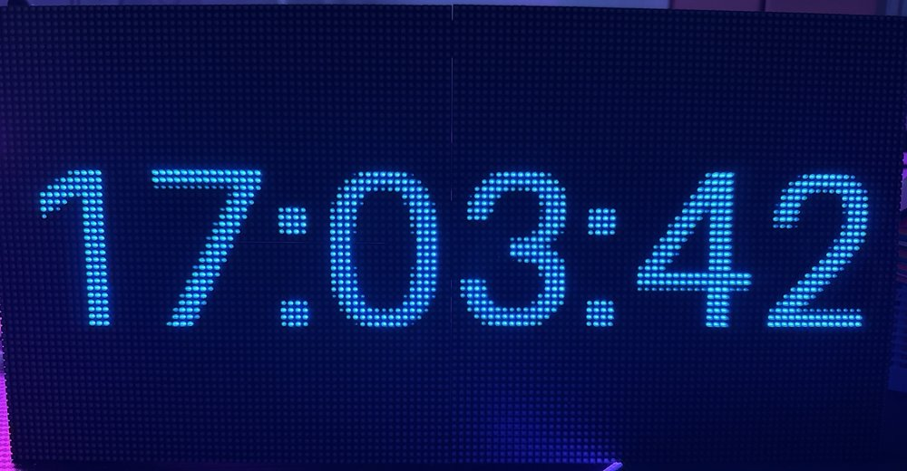
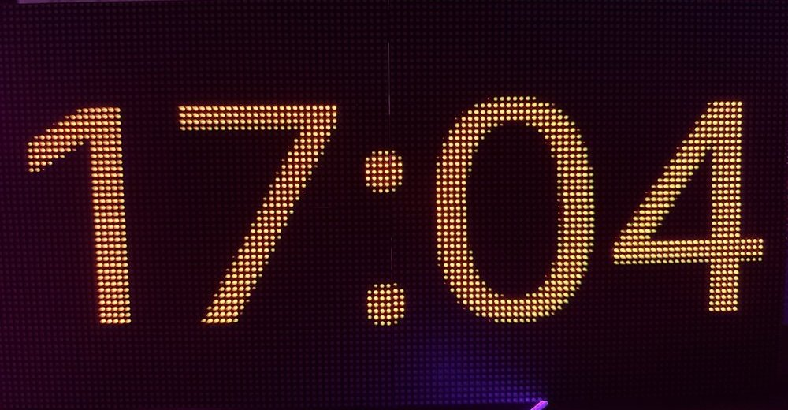
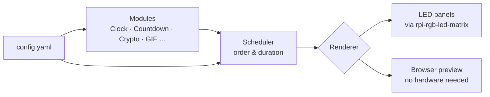
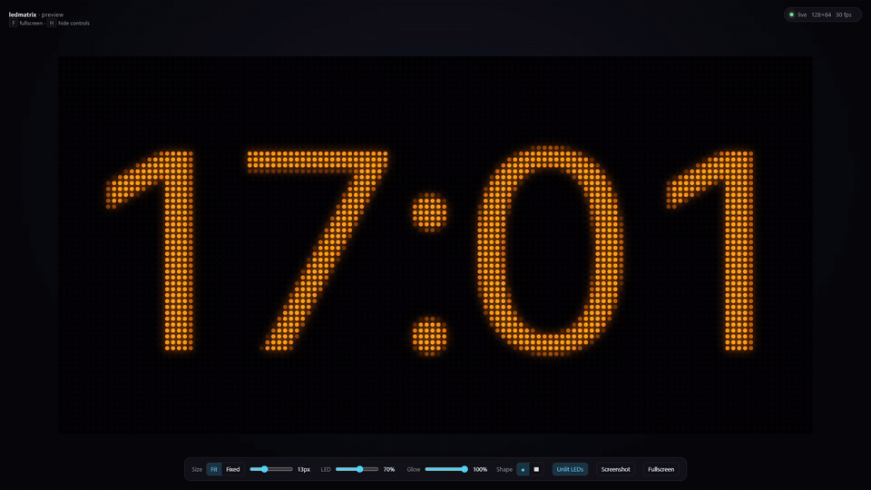

**English** | [Deutsch](/docs/README.de.md)

<div align="center">

# ✦ Waveshare P2.5 LED Matrix

**A modular display system for HUB75 LED panels on the Raspberry Pi.**<br>
Build your own modules – clocks, countdowns, crypto tickers, animations – and let them run seamlessly one after another.





</div>

---

## ✦ Idea

Not a single script, but a small platform: the system takes care of hardware,
timing and playback. You only write **modules** that define *what* is shown.
Everything that depends on your hardware lives in one config file – so the same code
runs on any panel size, chain length or wiring.

## ✦ Architecture



## ✦ Preview mode

Develop and test modules **without any panels** – the preview draws the matrix as
glowing LEDs in your browser, live at 30 fps.

<div align="center">

</div>

- Adjustable size, LED size, glow and LED shape (round or square)
- Shows the pixel coordinate under the mouse – handy when building modules
- Screenshot button, fullscreen with <kbd>F</kbd>, hide the controls with <kbd>H</kbd>
- Runs on the Pi as well as on any PC with Python

---

## ✦ Quick start

Tested on a Raspberry Pi 4 with Raspberry Pi OS Lite (64-bit), Python 3.13.

### 1 · System packages

```bash
sudo apt update
sudo apt install -y git build-essential python3-dev python3-venv cython3
```

### 2 · Disable the on-board sound

The built-in sound of the Pi uses the same hardware as the LED library and causes trouble.

```bash
echo "blacklist snd_bcm2835" | sudo tee /etc/modprobe.d/blacklist-rgb-matrix.conf
sudo reboot
```

### 3 · Get the code

```bash
cd ~
git clone https://github.com/hzeller/rpi-rgb-led-matrix.git
git clone https://github.com/gerry-git-ops/Waveshare-P2.5-LED-Matrix.git
cd Waveshare-P2.5-LED-Matrix
```

### 4 · Virtual environment and installation

```bash
python3 -m venv --system-site-packages .venv
source .venv/bin/activate

pip install ~/rpi-rgb-led-matrix   # Python bindings of the LED library (takes a few minutes)
pip install -e .                   # this project
```

### 5 · Configuration

```bash
cp config/config.example.yaml config/config.yaml
```

Adjust `config/config.yaml` to your panels – see [Configuration](#-configuration).

### 6 · Run

```bash
sudo .venv/bin/python -m ledmatrix          # on the LED panels (needs root for GPIO)
python -m ledmatrix --preview               # in the browser: http://localhost:8080
```

Stop with <kbd>Ctrl</kbd>+<kbd>C</kbd>.

> [!TIP]
> Working on the Pi over **VS Code Remote-SSH**? VS Code forwards port 8080 automatically –
> just click *Open in Browser*. With plain SSH: `ssh -L 8080:localhost:8080 user@your-pi`

<details>
<summary><b>Preview on a PC (Windows, macOS, Linux) – no Pi needed</b></summary>

<br>

You need Python 3.11 or newer. The LED library is **not** required for the preview.

```bash
git clone https://github.com/gerry-git-ops/Waveshare-P2.5-LED-Matrix.git
cd Waveshare-P2.5-LED-Matrix
python -m venv .venv
source .venv/bin/activate        # Windows: .venv\Scripts\activate
pip install -e .
cp config/config.example.yaml config/config.yaml   # Windows: copy config\config.example.yaml config\config.yaml
python -m ledmatrix --preview
```

Then open <http://localhost:8080>.

</details>

---

## ✦ Configuration

All settings live in `config/config.yaml`. Your own file is ignored by Git,
the template `config.example.yaml` is part of the repository.

```yaml
hardware:
  rows: 32                  # pixel rows per panel
  cols: 64                  # pixel columns per panel
  chain_length: 2           # panels per chain
  parallel: 2               # parallel chains (1-3)
  hardware_mapping: regular # GPIO mapping, see rpi-rgb-led-matrix
  gpio_slowdown: 4          # higher = slower, needed on faster Pis
  rgb_sequence: RBG         # color order of your panels
  brightness: 50            # 0-100

fps: 30                     # frames per second

modules:                    # played in this order, then from the start
  - type: clock
    duration: 5             # seconds
    color: [0, 150, 255]
    fmt: "%H:%M:%S"
```

The display size is calculated from the hardware section:
**width = `cols` × `chain_length`**, **height = `rows` × `parallel`** (here 128 × 64).

> [!IMPORTANT]
> The hardware section must match the panels that are **actually connected**.
> If it doesn't, panels show copies of the image or flicker.

Every module entry needs a `type` and optionally a `duration`.
All other keys are handed to the module as options.

## ✦ Modules

| Module | Description | Options | Status |
|--------|-------------|---------|--------|
| `clock` | Digital clock, scales itself to the display | `color`, `fmt` ([strftime](https://docs.python.org/3/library/time.html#time.strftime)) | ✅ |
| Scrolling text | Text with adjustable speed | | planned |
| Countdown | Days, hours, minutes until a date | | planned |
| GIF player | Play your own animations | | planned |
| Crypto ticker | Prices via web API, with history | | idea |

## ✦ Build your own module

A module is a small Python class: it gets the display size and returns one image per frame.
`t` is the time in seconds since the module became active – perfect for animations.

**1.** Create `src/ledmatrix/modules/bounce.py`:

```python
"""A dot moving from left to right."""

from PIL import Image, ImageDraw

from ledmatrix.modules.base import Module


class Bounce(Module):
    def __init__(self, width: int, height: int, color=(255, 0, 80)) -> None:
        super().__init__(width, height)
        self.color = tuple(color)

    def render(self, t: float) -> Image.Image:
        img = Image.new("RGB", (self.width, self.height))
        x = int(t * 40) % self.width
        y = self.height // 2
        ImageDraw.Draw(img).ellipse((x - 3, y - 3, x + 3, y + 3), fill=self.color)
        return img
```

**2.** Register it in `src/ledmatrix/modules/__init__.py`:

```python
from ledmatrix.modules.bounce import Bounce

REGISTRY = {
    "clock": Clock,
    "bounce": Bounce,
}
```

**3.** Add it to your `config/config.yaml`:

```yaml
  - type: bounce
    duration: 8
    color: [255, 0, 80]
```

Check it with `python -m ledmatrix --preview` – done.

> [!TIP]
> Always calculate with `self.width` and `self.height`, never with fixed numbers –
> then your module works on every panel setup.

---

## ✦ Project structure

```
Waveshare-P2.5-LED-Matrix/
├── config/
│   └── config.example.yaml     template for your config.yaml
├── docs/                       translations, roadmap, images
├── src/ledmatrix/
│   ├── __main__.py             entry point (python -m ledmatrix)
│   ├── config.py               load and validate the config
│   ├── renderer.py             output to the LED panels
│   ├── scheduler.py            plays the modules one after another
│   ├── modules/
│   │   ├── base.py             base class for all modules
│   │   └── clock.py            clock module
│   └── preview/
│       ├── renderer.py         web server for the browser preview
│       └── index.html          preview page
└── pyproject.toml              project metadata and dependencies
```

## ✦ Hardware

- **Raspberry Pi 4** (headless, via SSH)
- **4× Waveshare RGB-Matrix P2.5, 64×32** in a 2×2 grid → **128×64 pixels**
- Driven by [rpi-rgb-led-matrix](https://github.com/hzeller/rpi-rgb-led-matrix), GPIO mapping `regular`
- Custom wiring via the GPIO header, two parallel chains of two panels each
- Separate 5 V power supply for the panels (Waveshare: up to 2.5 A per panel)

*Wiring diagram and terminal plan will follow.*

## ✦ Troubleshooting

<details>
<summary><code>snd_bcm2835: found that the Pi sound module is loaded</code></summary>

<br>The on-board sound is still active. Do [step 2](#2--disable-the-on-board-sound) and reboot.
</details>

<details>
<summary><code>make: No rule to make target 'build-python'</code></summary>

<br>The Python bindings of rpi-rgb-led-matrix are built with `pip` since February 2026.
Use `pip install ~/rpi-rgb-led-matrix` inside the activated virtual environment.
</details>

<details>
<summary><code>ModuleNotFoundError: No module named 'ledmatrix'</code> or <code>'rgbmatrix'</code></summary>

<br>The virtual environment is not active – run `source .venv/bin/activate`.
With `sudo`, always use the Python of the venv: `sudo .venv/bin/python -m ledmatrix`.
</details>

<details>
<summary>Image appears twice, flickers or panels stay dark</summary>

<br>Check that `chain_length` and `parallel` match the panels that are really connected.
</details>

<details>
<summary>Wrong colors</summary>

<br>Try another `rgb_sequence` (e.g. `RBG`, `GRB`). A red text must appear red, a green one green.
</details>

<details>
<summary>One chain only shows some rows (stripes)</summary>

<br>An address line (A, B, C or D) is missing on that chain – check the wiring.
</details>

## ✦ Roadmap

What is planned and what is already running: [ROADMAP](/docs/roadmap.md)

---

<div align="center">
<sub>A project for learning, building and glowing.</sub>
</div>
