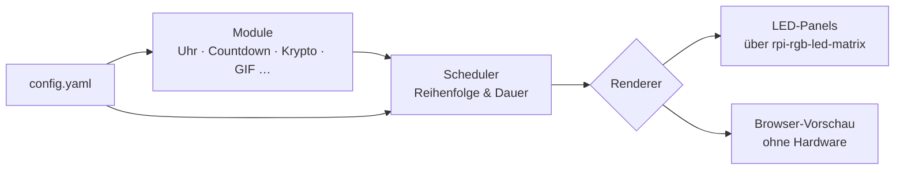
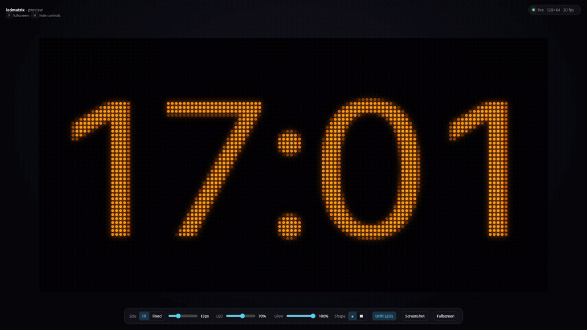

[English](../README.md) | **Deutsch**

<div align="center">

# ✦ Waveshare P2.5 LED Matrix

**Ein modulares Anzeigesystem für HUB75-LED-Panels am Raspberry Pi.**<br>
Baue eigene Module – Uhren, Countdowns, Krypto-Ticker, Animationen – und lass sie nahtlos nacheinander laufen.


</div>

---

## ✦ Idee

Kein einzelnes Skript, sondern eine kleine Plattform: Das System kümmert sich um Hardware,
Zeittakt und Ablauf. Du schreibst nur noch **Module**, die sagen, *was* angezeigt wird.
Alles, was von deiner Hardware abhängt, steht in einer einzigen Config-Datei – derselbe Code
läuft also mit jeder Panelgröße, Kettenlänge und Verdrahtung.

## ✦ Architektur



## ✦ Vorschau-Modus

Module entwickeln und testen **ganz ohne Panels** – die Vorschau zeichnet die Matrix als
leuchtende LEDs im Browser, live mit 30 Bildern pro Sekunde.

<div align="center">

</div>

- Größe, LED-Größe, Leuchten (Glow) und LED-Form (rund oder eckig) einstellbar
- Zeigt die Pixel-Koordinate unter der Maus – praktisch beim Bauen von Modulen
- Screenshot-Knopf, Vollbild mit <kbd>F</kbd>, Bedienleiste ausblenden mit <kbd>H</kbd>
- Läuft auf dem Pi genauso wie auf jedem PC mit Python

---

## ✦ Schnellstart

Getestet auf einem Raspberry Pi 4 mit Raspberry Pi OS Lite (64-Bit), Python 3.13.

### 1 · Systempakete

```bash
sudo apt update
sudo apt install -y git build-essential python3-dev python3-venv cython3
```

### 2 · Onboard-Sound abschalten

Der eingebaute Sound des Pi nutzt dieselbe Hardware wie die LED-Bibliothek und macht Probleme.

```bash
echo "blacklist snd_bcm2835" | sudo tee /etc/modprobe.d/blacklist-rgb-matrix.conf
sudo reboot
```

### 3 · Code holen

```bash
cd ~
git clone https://github.com/hzeller/rpi-rgb-led-matrix.git
git clone https://github.com/gerry-git-ops/Waveshare-P2.5-LED-Matrix.git
cd Waveshare-P2.5-LED-Matrix
```

### 4 · Virtuelle Umgebung und Installation

```bash
python3 -m venv --system-site-packages .venv
source .venv/bin/activate

pip install ~/rpi-rgb-led-matrix   # Python-Anbindung der LED-Bibliothek (dauert ein paar Minuten)
pip install -e .                   # dieses Projekt
```

### 5 · Konfiguration

```bash
cp config/config.example.yaml config/config.yaml
```

`config/config.yaml` an deine Panels anpassen – siehe [Konfiguration](#-konfiguration).

### 6 · Starten

```bash
sudo .venv/bin/python -m ledmatrix          # auf den LED-Panels (braucht root für die GPIOs)
python -m ledmatrix --preview               # im Browser: http://localhost:8080
```

Beenden mit <kbd>Strg</kbd>+<kbd>C</kbd>.

> [!TIP]
> Du arbeitest per **VS Code Remote-SSH** auf dem Pi? VS Code leitet Port 8080 automatisch weiter –
> einfach auf *Im Browser öffnen* klicken. Mit normalem SSH: `ssh -L 8080:localhost:8080 user@dein-pi`

<details>
<summary><b>Vorschau am PC (Windows, macOS, Linux) – ganz ohne Pi</b></summary>

<br>

Du brauchst Python 3.11 oder neuer. Die LED-Bibliothek ist für die Vorschau **nicht** nötig.

```bash
git clone https://github.com/gerry-git-ops/Waveshare-P2.5-LED-Matrix.git
cd Waveshare-P2.5-LED-Matrix
python -m venv .venv
source .venv/bin/activate        # Windows: .venv\Scripts\activate
pip install -e .
cp config/config.example.yaml config/config.yaml   # Windows: copy config\config.example.yaml config\config.yaml
python -m ledmatrix --preview
```

Dann <http://localhost:8080> öffnen.

</details>

---

## ✦ Konfiguration

Alle Einstellungen stehen in `config/config.yaml`. Deine eigene Datei wird von Git ignoriert,
die Vorlage `config.example.yaml` gehört zum Repository.

```yaml
hardware:
  rows: 32                  # pixel rows per panel
  cols: 64                  # pixel columns per panel
  chain_length: 2           # panels per chain
  parallel: 2               # parallel chains (1-3)
  hardware_mapping: regular # GPIO mapping, see rpi-rgb-led-matrix
  gpio_slowdown: 4          # higher = slower, needed on faster Pis
  rgb_sequence: RBG         # color order of your panels
  brightness: 50            # 0-100

fps: 30                     # frames per second

modules:                    # played in this order, then from the start
  - type: clock
    duration: 5             # seconds
    color: [0, 150, 255]
    fmt: "%H:%M:%S"
```

Die Anzeigegröße wird aus dem Hardware-Teil berechnet:
**Breite = `cols` × `chain_length`**, **Höhe = `rows` × `parallel`** (hier 128 × 64).

> [!IMPORTANT]
> Der Hardware-Teil muss zu den Panels passen, die **tatsächlich angeschlossen** sind.
> Sonst zeigen Panels Kopien des Bildes oder flackern.

Jeder Modul-Eintrag braucht einen `type` und optional eine `duration` (Sekunden).
Alle weiteren Angaben bekommt das Modul als Optionen.

## ✦ Module

| Modul | Beschreibung | Optionen | Status |
|-------|--------------|----------|--------|
| `clock` | Digitale Uhr, passt sich selbst an die Anzeige an | `color`, `fmt` ([strftime](https://docs.python.org/3/library/time.html#time.strftime)) | ✅ |
| Lauftext | Text mit einstellbarer Geschwindigkeit | | geplant |
| Countdown | Tage, Stunden, Minuten bis zu einem Datum | | geplant |
| GIF-Player | Eigene Animationen abspielen | | geplant |
| Krypto-Ticker | Kurse per Web-API, mit Verlauf | | Idee |

## ✦ Eigenes Modul bauen

Ein Modul ist eine kleine Python-Klasse: Sie bekommt die Anzeigegröße und liefert pro Frame ein Bild.
`t` ist die Zeit in Sekunden, seit das Modul aktiv ist – ideal für Animationen.

**1.** `src/ledmatrix/modules/bounce.py` anlegen:

```python
"""A dot moving from left to right."""

from PIL import Image, ImageDraw

from ledmatrix.modules.base import Module


class Bounce(Module):
    def __init__(self, width: int, height: int, color=(255, 0, 80)) -> None:
        super().__init__(width, height)
        self.color = tuple(color)

    def render(self, t: float) -> Image.Image:
        img = Image.new("RGB", (self.width, self.height))
        x = int(t * 40) % self.width
        y = self.height // 2
        ImageDraw.Draw(img).ellipse((x - 3, y - 3, x + 3, y + 3), fill=self.color)
        return img
```

**2.** In `src/ledmatrix/modules/__init__.py` eintragen:

```python
from ledmatrix.modules.bounce import Bounce

REGISTRY = {
    "clock": Clock,
    "bounce": Bounce,
}
```

**3.** In deiner `config/config.yaml` ergänzen:

```yaml
  - type: bounce
    duration: 8
    color: [255, 0, 80]
```

Mit `python -m ledmatrix --preview` anschauen – fertig.

> [!TIP]
> Immer mit `self.width` und `self.height` rechnen, nie mit festen Zahlen –
> dann läuft dein Modul auf jedem Panel-Aufbau.

---

## ✦ Projektstruktur

```
Waveshare-P2.5-LED-Matrix/
├── config/
│   └── config.example.yaml     Vorlage für deine config.yaml
├── docs/                       Übersetzungen, Roadmap, Bilder
├── src/ledmatrix/
│   ├── __main__.py             Startpunkt (python -m ledmatrix)
│   ├── config.py               Config einlesen und prüfen
│   ├── renderer.py             Ausgabe auf die LED-Panels
│   ├── scheduler.py            spielt die Module nacheinander ab
│   ├── modules/
│   │   ├── base.py             Basisklasse für alle Module
│   │   └── clock.py            Uhr-Modul
│   └── preview/
│       ├── renderer.py         Webserver für die Browser-Vorschau
│       └── index.html          Vorschau-Seite
└── pyproject.toml              Projektbeschreibung und Abhängigkeiten
```

## ✦ Hardware

- **Raspberry Pi 4** (ohne Desktop, per SSH)
- **4× Waveshare RGB-Matrix P2.5, 64×32** im 2×2-Raster → **128×64 Pixel**
- Ansteuerung über [rpi-rgb-led-matrix](https://github.com/hzeller/rpi-rgb-led-matrix), GPIO-Mapping `regular`
- Eigene Verdrahtung über die GPIO-Leiste, zwei parallele Ketten mit je zwei Panels
- Eigenes 5-V-Netzteil für die Panels (laut Waveshare bis 2,5 A pro Panel)

*Schaltplan und Klemmenplan folgen.*

## ✦ Fehlersuche

<details>
<summary><code>snd_bcm2835: found that the Pi sound module is loaded</code></summary>

<br>Der Onboard-Sound ist noch aktiv. [Schritt 2](#2--onboard-sound-abschalten) ausführen und neu starten.
</details>

<details>
<summary><code>make: No rule to make target 'build-python'</code></summary>

<br>Die Python-Anbindung von rpi-rgb-led-matrix wird seit Februar 2026 mit `pip` gebaut.
In der aktivierten venv `pip install ~/rpi-rgb-led-matrix` verwenden.
</details>

<details>
<summary><code>ModuleNotFoundError: No module named 'ledmatrix'</code> oder <code>'rgbmatrix'</code></summary>

<br>Die venv ist nicht aktiv – `source .venv/bin/activate` ausführen.
Mit `sudo` immer das Python der venv nehmen: `sudo .venv/bin/python -m ledmatrix`.
</details>

<details>
<summary>Bild doppelt, Flackern oder Panels bleiben dunkel</summary>

<br>Prüfen, ob `chain_length` und `parallel` zu den wirklich angeschlossenen Panels passen.
</details>

<details>
<summary>Falsche Farben</summary>

<br>Eine andere `rgb_sequence` probieren (z. B. `RBG`, `GRB`). Roter Text muss rot sein, grüner grün.
</details>

<details>
<summary>Eine Kette zeigt nur einzelne Zeilen (Streifen)</summary>

<br>Auf dieser Kette fehlt eine Adressleitung (A, B, C oder D) – Verdrahtung prüfen.
</details>

## ✦ Lizenz

Dieses Projekt steht unter der [GNU General Public License v3.0](../LICENSE).

Es baut auf [rpi-rgb-led-matrix](https://github.com/hzeller/rpi-rgb-led-matrix) von Henner Zeller (GPL) auf.
Die mitgelieferte Schrift [Inter](https://github.com/rsms/inter) steht unter der
[SIL Open Font License 1.1](../src/ledmatrix/assets/fonts/OFL.txt).

## ✦ Roadmap

Was geplant ist und was schon läuft: [ROADMAP](roadmap.de.md)

---

<div align="center">
<sub>Ein Projekt zum Lernen, Bauen und Leuchten.</sub>
</div>
