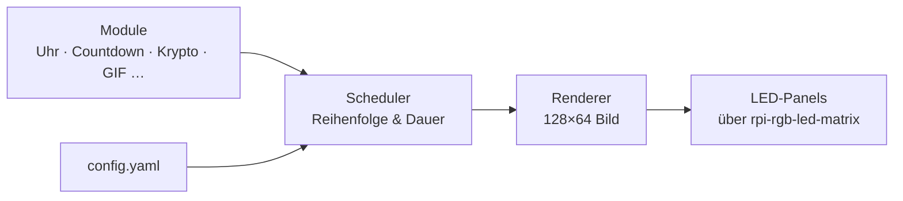

[English](../README.md) | **Deutsch**

<div align="center">

# ✦ Waveshare P2.5 LED Matrix

**Ein modulares Anzeigesystem für HUB75-LED-Panels am Raspberry Pi.**
Baue eigene Module – Uhren, Countdowns, Krypto-Ticker, Animationen – und lass sie nahtlos nacheinander laufen.


</div>

---

## Idee

Kein einzelnes Skript, sondern eine kleine Plattform: Das System kümmert sich um Hardware,
Zeittakt und Ablauf. Du schreibst nur noch **Module**, die sagen, *was* angezeigt wird.

## Architektur



## Module

| Modul | Beschreibung | Status |
|-------|--------------|--------|
| Uhr | Digitale Uhr in verschiedenen Stilen | geplant |
| Countdown | Tage, Stunden, Minuten bis zu einem Datum | geplant |
| Krypto-Ticker | Kurse per Web-API, mit Verlauf | geplant |
| GIF-Player | Eigene Animationen abspielen | geplant |
| Lauftext | Text mit frei wählbarer Geschwindigkeit | geplant |

## Eigenes Modul bauen

Jedes Modul ist eine kleine Python-Klasse, die pro Frame ein Bild zurückgibt.
*(Entwurf – die genaue Schnittstelle entsteht im Projekt und kann sich noch ändern.)*

```python
class MeinModul(Module):
    duration = 10  # Sekunden

    def render(self, t):
        ...  # Bild für den Zeitpunkt t zurückgeben
```

## Hardware

- **Raspberry Pi 4** (Betrieb ohne Desktop, per SSH)
- **4× Waveshare RGB-Matrix P2.5, 64×32** im 2×2-Raster → **128×64 Pixel**
- Ansteuerung über [rpi-rgb-led-matrix](https://github.com/hzeller/rpi-rgb-led-matrix)
- Eigene Verdrahtung über die GPIO-Leiste, zwei parallele Ketten mit je zwei Panels


## Roadmap

Was geplant ist und was schon läuft: siehe 
- [ROADMAP](/docs/roadmap.de.md)

---

<div align="center">
<sub>Ein Projekt zum Lernen, Bauen und Leuchten.</sub>
</div>