[English](../README.md) | **Deutsch**

<div align="center">

# ✦ Waveshare P2.5 LED Matrix

**Ein modulares Anzeigesystem für HUB75-LED-Panels am Raspberry Pi.**<br>
Baue eigene Module – Uhren, Countdowns, Krypto-Ticker, Animationen – und lass sie nahtlos nacheinander laufen.


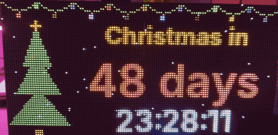

<sub>Echte Panels, echte Zeit: Weihnachts-Countdown und zwei Uhr-Varianten im Wechsel.</sub>

</div>

---

## 🎄 Saison-Highlight: Weihnachts-Countdown

Bring deine Matrix in Weihnachtsstimmung: eine funkelnde Lichterkette, ein Tannenbaum mit leuchtendem Stern,
sanft fallender Schnee – und ein großer Countdown bis Heiligabend. An Heiligabend wechselt die Anzeige
zu einem bunten Weihnachtsgruß, und nach den Feiertagen zählt sie von selbst auf das nächste Weihnachten hin.

<div align="center">
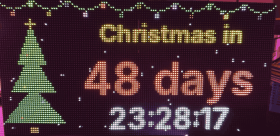
</div>

Er spricht deine Sprache – Englisch, Deutsch, Französisch und Spanisch sind eingebaut:

<div align="center">
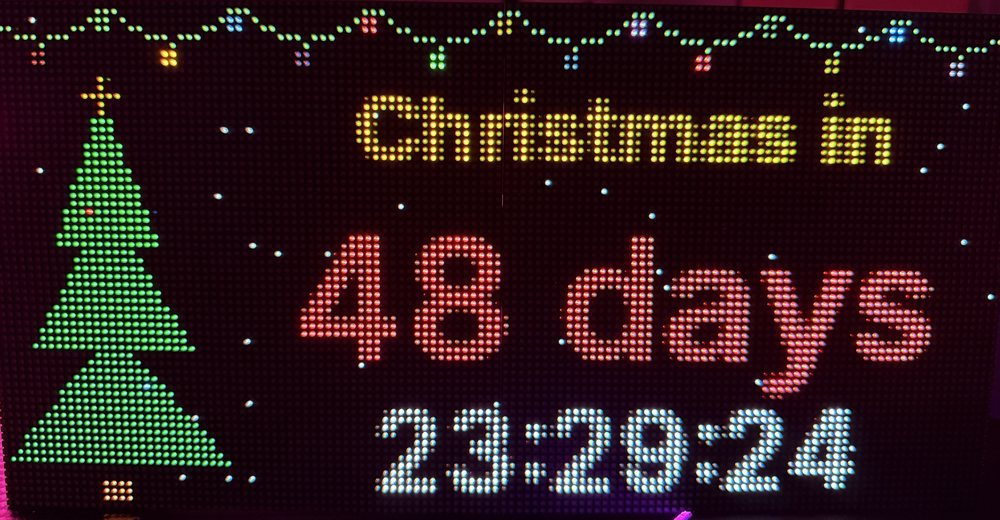
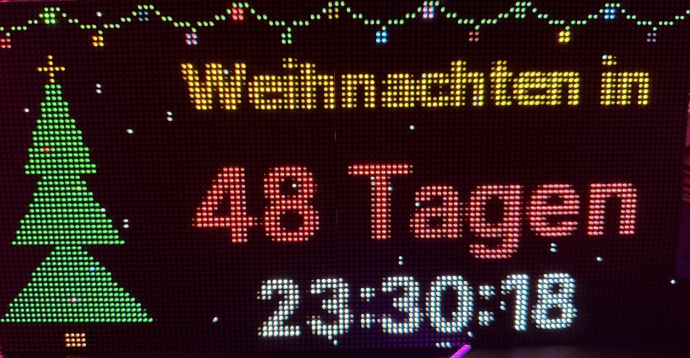
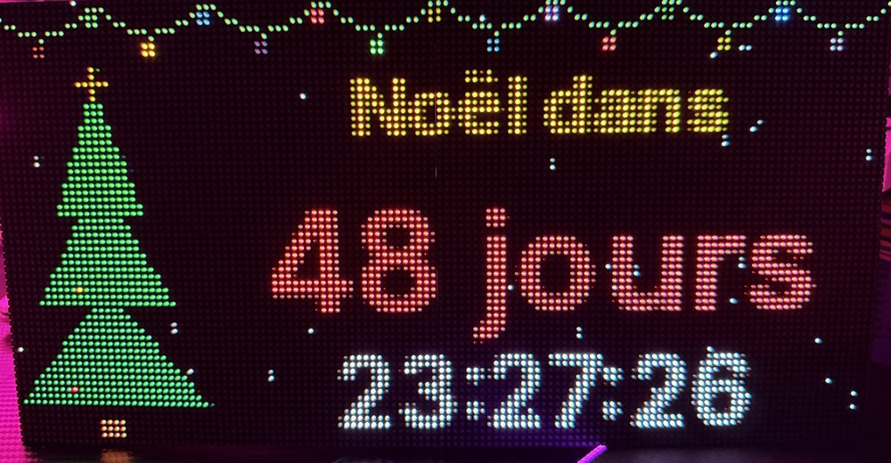
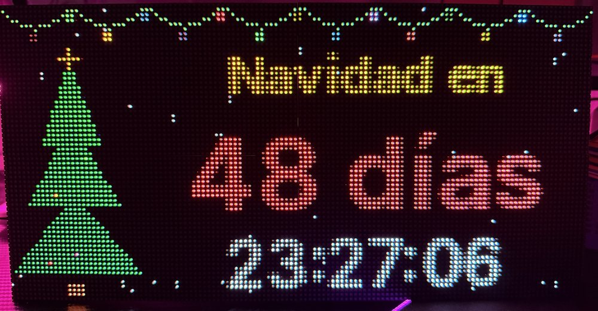
</div>

In deine `config/config.yaml` eintragen:

```yaml
language: de                # en, de, fr, es

modules:
  - type: christmas
    duration: 15
    hour: 18                # Christmas Eve at 18:00, 0 = midnight
    snow: 40                # number of snowflakes, 0 = no snow
```

Eigene Texte? Jeder Text lässt sich direkt in der Config ersetzen – siehe [Sprachen](#-sprachen).

---

## 🚢 Highlight: Reise-Countdown

Du zählst die Tage bis zur nächsten Reise? Am Horizont taucht ein Schiff auf, kommt näher und
kracht mitten in den Countdown – die Zeit zerspringt in hunderte Pixel. Das Schiff zieht sie in
seinem Kielwasser mit und lässt sie an ihren Platz fallen: deine Reisedaten. Himmel, Wolken und
Wellen bewegen sich die ganze Zeit.

<div align="center">
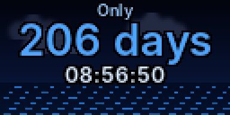
</div>

```yaml
  - type: voyage
    date: "2027-06-01 00:00"    # Abfahrt: "JJJJ-MM-TT" oder "JJJJ-MM-TT HH:MM"
    lines:                      # erscheinen nach dem Schiff, 1-4 Zeilen
      - "Meine Kreuzfahrt"
      - "Karibik"
      - "Miami - Miami"
    ship_speed: 1.0             # 2.0 = doppelt so schnell, 0.5 = halb so schnell
    hold: 6                     # Sekunden, die die Zeilen stehen bleiben
    palette: blue               # red, orange, gold, green, cyan, blue, purple, pink
    # ship: private/my_ship.png # optional, eigenes Schiffsbild (PNG mit Transparenz)
    finale:                     # optional: GIFs oder Bilder nach den Zeilen
      - file: examples/star.gif   # ein GIF ohne hold läuft einmal durch
      - file: examples/cruise_ship.png
        hold: 3                   # ein Bild steht so viele Sekunden
    transition: fade            # fade oder fade_black
    transition_time: 1.5        # Sekunden, kommen zu den hold-Zeiten dazu
```

| Option | Bedeutung |
|--------|-----------|
| `date` | Abfahrt – bis dahin läuft der Countdown |
| `lines` | deine Reisedaten nach dem Schiff, 1–4 Zeilen |
| `ship_speed` | Tempo des Schiffs – die ganze Szene wird damit kürzer oder länger |
| `hold` | Sekunden, die die Reisedaten stehen bleiben |
| `palette` | Farbset für alle Texte: `red`, `orange`, `gold`, `green`, `cyan`, `blue`, `purple`, `pink` |
| `title_color`, `days_color`, `time_color`, `line_colors` | einzelne Farben, sie gehen vor der Palette |
| `ship` | dein eigenes Schiff als PNG mit Transparenz – Standard ist das mitgelieferte `examples/cruise_ship.png` |
| `finale` | Liste von GIFs oder Bildern nach den Reisedaten – jeder Eintrag hat `file`, optional `hold` (Sekunden) und `fit` (`contain`, `cover`, `stretch`) |
| `transition` | wie die Teile des Finales ineinander übergehen: `fade` oder `fade_black` |
| `transition_time` | Sekunden pro Übergang – sie kommen obendrauf, jeder Teil steht seine volle Zeit |

### Eigenes Video als Finale

Jedes Video, **das du verwenden darfst**, lässt sich mit [ffmpeg](https://ffmpeg.org) in ein passendes GIF umwandeln:

```bash
sudo apt install -y ffmpeg
ffmpeg -ss 69 -to 84 -i private/my_video.mp4 \
  -vf "fps=20,crop=iw*0.75:iw*0.375,eq=contrast=1.35:saturation=1.7:gamma=1.4,scale=128:64:flags=lanczos,split[a][b];[a]palettegen[p];[b][p]paletteuse" \
  private/clip.gif
```

| Teil | Was er macht |
|------|--------------|
| `-ss 69 -to 84` | Ausschnitt von Sekunde 69 bis 84 |
| `fps=20` | 20 Bilder pro Sekunde reichen auf den Panels und halten die Datei klein |
| `crop=iw*0.75:iw*0.375` | schneidet die Mitte im Seitenverhältnis 2:1 der Matrix aus, 75 % der Videobreite – kleinere Werte zoomen weiter heran |
| `eq=…` | mehr Kontrast und Farbe, hellere dunkle Töne – die gehen auf LEDs sonst unter |
| `scale=128:64` | deine Displaygröße (`cols × chain_length` mal `rows × parallel`) |
| `palettegen` / `paletteuse` | sucht die 256 besten Farben für genau diesen Clip – keine Farbstreifen |

Danach `- file: private/clip.gif` ins `finale` eintragen.

> [!TIP]
> **Du brauchst ein anderes Schiff?** Nimm dein eigenes Bild mit `ship:` (Bilder, die du nicht
> weitergeben darfst, gehören nach `private/`) – oder [eröffne ein Issue](https://github.com/gerry-git-ops/Waveshare-P2.5-LED-Matrix/issues/new)
> und beschreib das Schiff, das du sehen möchtest.

---

## ✦ Idee

Kein einzelnes Skript, sondern eine kleine Plattform: Das System kümmert sich um Hardware,
Zeittakt und Ablauf. Du schreibst nur noch **Module**, die sagen, *was* angezeigt wird.
Alles, was von deiner Hardware abhängt, steht in einer einzigen Config-Datei – derselbe Code
läuft also mit jeder Panelgröße, Kettenlänge und Verdrahtung.

## ✦ Architektur

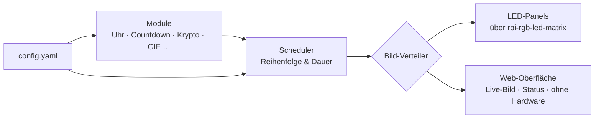

## ✦ Web-Oberfläche

Schau deiner Matrix in jedem Browser im Heimnetz zu – am PC, Tablet oder Handy.
Sie läuft neben den Panels oder ganz **ohne Hardware**.

<div align="center">
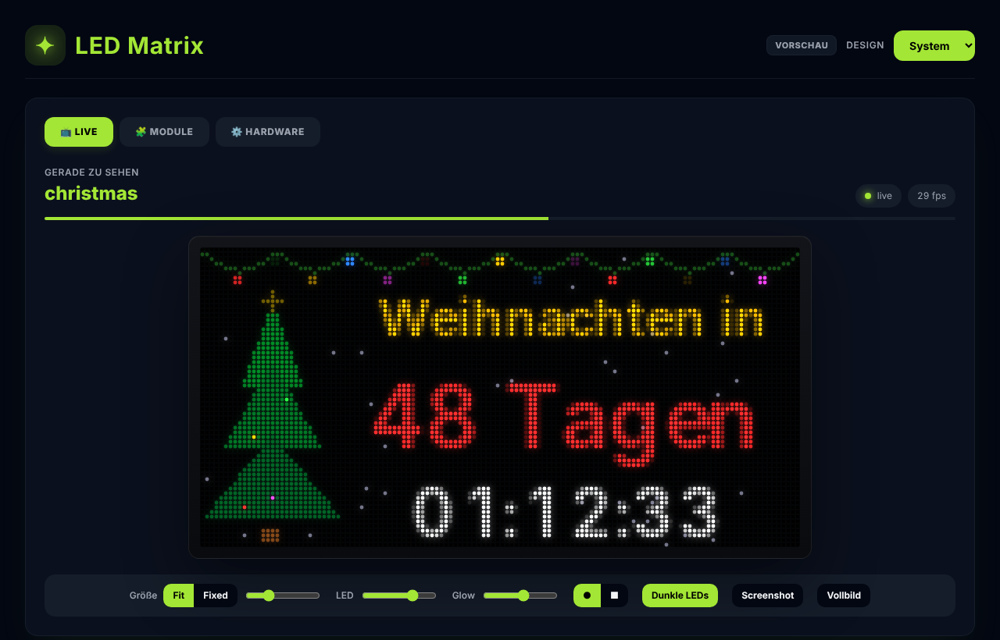
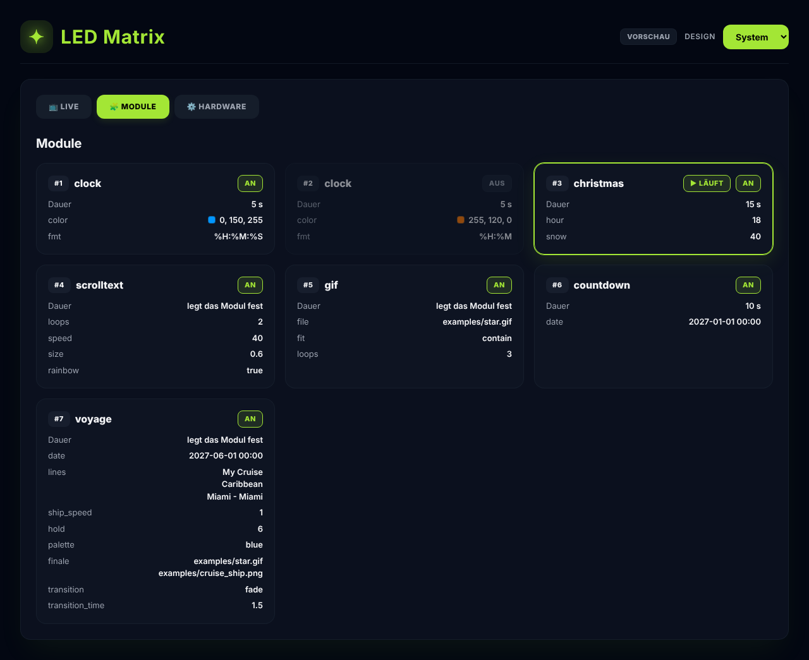
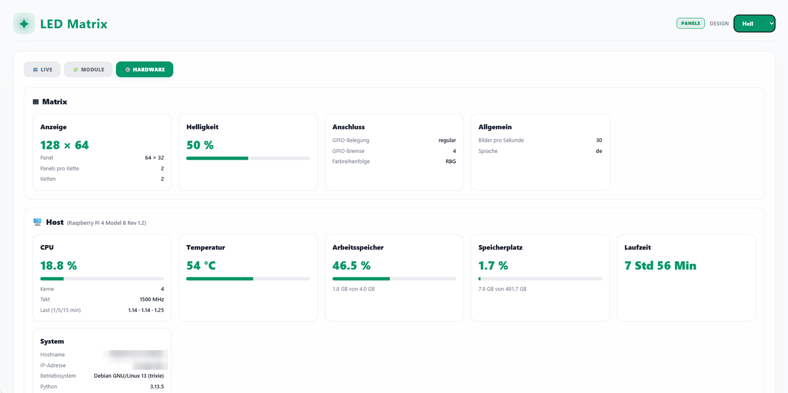
</div>

- **Live** – das Bild der Panels als leuchtende LEDs: LED-Größe, Leuchten, runde oder eckige LEDs,
  Screenshot, Vollbild und die Pixel-Koordinate unter der Maus
- **Gerade zu sehen** – welches Modul läuft, wie lange noch, echte Bilder pro Sekunde
- **Module** – alle Module deiner Config, an oder aus, mit ihren Optionen (Farben als Farbfelder)
- **Hardware** – Displaygröße, Panels, Ketten, Helligkeit und Anschluss auf einen Blick
- **Design** – System, Hell oder Dunkel; die Texte folgen `language` (en, de, fr, es)
- **API** – JSON unter `/api/status`, `/api/config`, `/api/modules` – für andere Geräte und Skripte.
  Das laufende Programm beschreibt sie selbst: `http://<IP deines Pi>:8080/api/docs` öffnen
  (eine interaktive Seite von FastAPI, keine Datei im Repository)

Die Web-Oberfläche ist **optional**: installieren mit `pip install -e ".[web]"`,
abschalten mit `web: {enabled: false}` in der Config.

> [!IMPORTANT]
> Die Web-Oberfläche hat **kein Passwort** und ist für dein **Heimnetz** gedacht.
> Von unterwegs nur über ein **VPN** (zum Beispiel das deines Routers) –
> **niemals** einen Port dafür im Router freigeben.

### Ohne Hardware ausprobieren

Kein Pi, keine Panels? Alles läuft auch auf deinem PC (Windows, macOS, Linux) – Module, Ablauf und
Web-Oberfläche, genau wie auf dem Pi. Nur werden keine Panels angesteuert. Ideal, um eigene Module
zu bauen, bevor du etwas kaufst. Du brauchst Python 3.11 oder neuer.

```bash
git clone https://github.com/gerry-git-ops/Waveshare-P2.5-LED-Matrix.git
cd Waveshare-P2.5-LED-Matrix
python -m venv .venv
source .venv/bin/activate        # Windows: .venv\Scripts\activate
pip install -e ".[web]"
cp config/config.example.yaml config/config.yaml   # Windows: copy config\config.example.yaml config\config.yaml
ledmatrix-preview
```

Dann <http://localhost:8080> öffnen.

---

## ✦ Schnellstart

Getestet auf einem Raspberry Pi 4 mit Raspberry Pi OS Lite (64-Bit), Python 3.13.

### 1 · Systempakete

```bash
sudo apt update
sudo apt install -y git build-essential python3-dev python3-venv cython3
```

### 2 · Onboard-Sound abschalten

Der eingebaute Sound des Pi nutzt dieselbe Hardware wie die LED-Bibliothek und macht Probleme.

```bash
echo "blacklist snd_bcm2835" | sudo tee /etc/modprobe.d/blacklist-rgb-matrix.conf
sudo reboot
```

### 3 · Code holen

```bash
cd ~
git clone https://github.com/hzeller/rpi-rgb-led-matrix.git
git clone https://github.com/gerry-git-ops/Waveshare-P2.5-LED-Matrix.git
cd Waveshare-P2.5-LED-Matrix
```

### 4 · Virtuelle Umgebung und Installation

```bash
python3 -m venv --system-site-packages .venv
source .venv/bin/activate

pip install ~/rpi-rgb-led-matrix   # Python-Anbindung der LED-Bibliothek (dauert ein paar Minuten)
pip install -e ".[web]"            # dieses Projekt mit Web-Oberfläche
# oder: pip install -e .           # ohne Web-Oberfläche
```

### 5 · Konfiguration

```bash
cp config/config.example.yaml config/config.yaml
```

`config/config.yaml` an deine Panels anpassen – siehe [Konfiguration](#-konfiguration).

### 6 · Starten

```bash
sudo .venv/bin/python -m ledmatrix          # Panels + Web-Oberfläche (braucht root für die GPIOs)
```

Die [Web-Oberfläche](#-web-oberfläche) öffnest du unter `http://<IP deines Pi>:8080` – die IP zeigt `hostname -I`.
Beenden mit <kbd>Strg</kbd>+<kbd>C</kbd>.

> [!TIP]
> Du arbeitest per **VS Code Remote-SSH** auf dem Pi? VS Code leitet Port 8080 automatisch weiter –
> einfach auf *Im Browser öffnen* klicken. Mit normalem SSH: `ssh -L 8080:localhost:8080 user@dein-pi`

> Noch kein Pi? Siehe [Ohne Hardware ausprobieren](#ohne-hardware-ausprobieren).

---

## ✦ Konfiguration

Alle Einstellungen stehen in `config/config.yaml`. Deine eigene Datei wird von Git ignoriert,
die Vorlage `config.example.yaml` gehört zum Repository.

```yaml
hardware:
  rows: 32                  # pixel rows per panel
  cols: 64                  # pixel columns per panel
  chain_length: 2           # panels per chain
  parallel: 2               # parallel chains (1-3)
  hardware_mapping: regular # GPIO mapping, see rpi-rgb-led-matrix
  gpio_slowdown: 4          # higher = slower, needed on faster Pis
  rgb_sequence: RBG         # color order of your panels
  brightness: 50            # 0-100

fps: 30                     # frames per second
language: en                # en, de, fr, es – missing texts fall back to English

web:                        # optional, das sind die Standardwerte
  enabled: true             # Web-Oberfläche (braucht: pip install -e ".[web]")
  port: 8080

modules:                    # played in this order, then from the start
  - type: clock
    duration: 5             # seconds
    color: [0, 150, 255]
    fmt: "%H:%M:%S"

  - type: christmas
    duration: 15
    hour: 18
```

Die Anzeigegröße wird aus dem Hardware-Teil berechnet:
**Breite = `cols` × `chain_length`**, **Höhe = `rows` × `parallel`** (hier 128 × 64).

> [!IMPORTANT]
> Der Hardware-Teil muss zu den Panels passen, die **tatsächlich angeschlossen** sind.
> Sonst zeigen Panels Kopien des Bildes oder flackern.

Jeder Modul-Eintrag braucht einen `type`. Für jedes Modul optional:

| Schlüssel | Bedeutung |
|-----------|-----------|
| `enabled` | `false` schaltet das Modul aus, ohne es zu löschen (Standard: `true`) |
| `duration` | Sekunden auf dem Display – fehlt sie, entscheidet das Modul selbst (z. B. `scrolltext` über seine Durchläufe) |

Alle weiteren Angaben bekommt das Modul als Optionen.

### ✦ Sprachen

`language` legt die Sprache für alle Module fest. Eingebaut sind **Englisch** (`en`), **Deutsch** (`de`),
**Französisch** (`fr`) und **Spanisch** (`es`). Fehlt ein Text in deiner Sprache, wird Englisch genommen –
es bricht also nichts.

**Einzelne Texte ändern** geht direkt in der Config, ganz ohne Code. Einfach den Text-Schlüssel des Moduls verwenden:

```yaml
  - type: christmas
    title: "Nur noch"       # statt "Weihnachten in"
    done: "Ho ho ho!"       # statt "Frohe Weihnachten!"
```

| Modul | Text-Schlüssel |
|-------|----------------|
| `christmas` | `title`, `days`, `day`, `done` |
| `countdown` | `title`, `days`, `day`, `done` |
| `voyage` | `title`, `days`, `day`, `trip` (Endzeile, wenn keine `lines` gesetzt sind) |
| `scrolltext` | `text` |

**Deine Sprache fehlt?** Ergänze sie in den `texts` des Moduls (siehe
[Eigenes Modul bauen](#-eigenes-modul-bauen)) und schick einen Pull Request – Beiträge sind sehr willkommen.

## ✦ Module

| Modul | Beschreibung | Optionen | Status |
|-------|--------------|----------|--------|
| `clock` | Digitale Uhr, passt sich selbst an die Anzeige an | `color`, `fmt` ([strftime](https://docs.python.org/3/library/time.html#time.strftime)) | ✅ |
| `christmas` | 🎄 Countdown bis Heiligabend mit Lichterkette, Baum und Schnee | `hour`, `snow`, [Texte](#-sprachen) | ✅ |
| `scrolltext` | Lauftext in einer Farbe oder im Regenbogen, läuft eine festgelegte Anzahl Mal durch | `loops`, `speed`, `size`, `color`, `rainbow`, [`text`](#-sprachen) | ✅ |
| `countdown` | Tage und Zeit bis zu einem beliebigen Datum, danach ein eigener Text | `date`, `title_color`, `days_color`, `time_color`, [Texte](#-sprachen) | ✅ |
| `gif` | Spielt ein animiertes GIF eine festgelegte Anzahl Mal ab | `file`, `fit`, `speed`, `loops` | ✅ |
| `voyage` | 🚢 Ein Schiff kracht in den Countdown und zieht deine Reisedaten an ihren Platz | [siehe oben](#-highlight-reise-countdown) | ✅ |
| Krypto-Ticker | Kurse per Web-API, mit Verlauf | | Idee |

<div align="center">
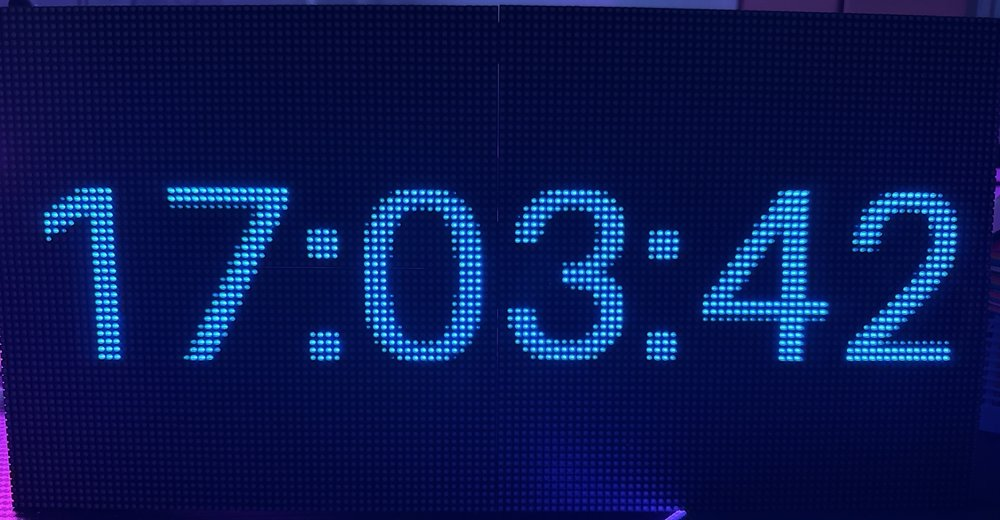
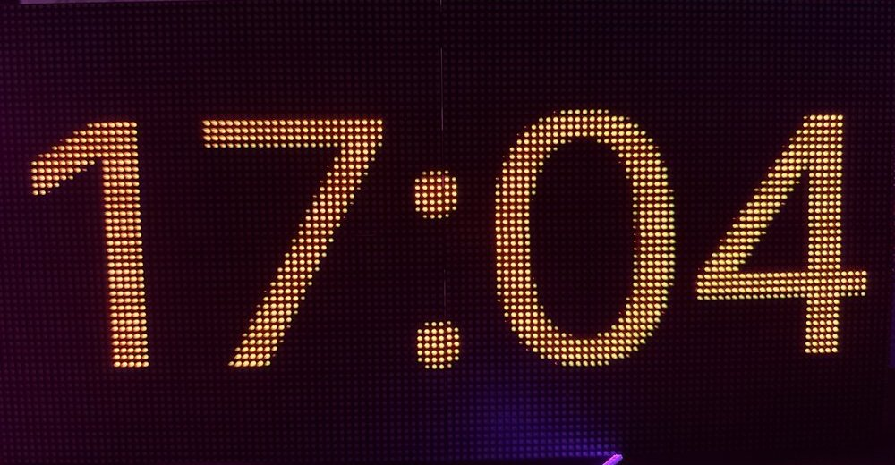
<br><sub>Zweimal dasselbe <code>clock</code>-Modul – nur <code>color</code> und <code>fmt</code> sind anders.</sub>
</div>

<div align="center">
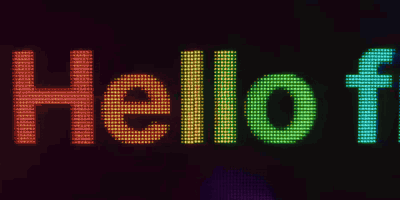
<br><sub><code>scrolltext</code> mit <code>rainbow: true</code> – er läuft <code>loops</code>-mal komplett durch, dann kommt das nächste Modul.</sub>
</div>

```yaml
  - type: scrolltext
    loops: 2                # how often the text runs through completely
    speed: 40               # pixels per second
    size: 0.6               # text height, share of the display height
    rainbow: true           # or: color: [255, 255, 255]
    # text: "Your own text" # optional, replaces the translated default text
```

> [!NOTE]
> Beim `scrolltext` keine `duration` angeben – sonst überstimmt sie die Durchläufe.

<div align="center">
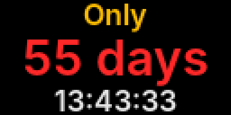
<br><sub><code>countdown</code> – oben der Titel, darunter Tage und Zeit. Ist das Datum erreicht, erscheint der <code>done</code>-Text.</sub>
</div>

```yaml
  - type: countdown
    duration: 10
    date: "2027-01-01 00:00"  # "JJJJ-MM-TT" oder "JJJJ-MM-TT HH:MM"
    title: "Urlaub in"        # optional, ersetzt den übersetzten Titel
    done: "Viel Spaß!"        # optional, erscheint, wenn das Datum erreicht ist
```

<div align="center">
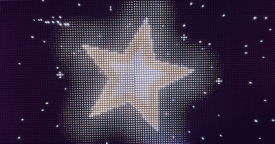
<br><sub><code>gif</code> spielt das mitgelieferte Beispiel <code>examples/star.gif</code> – eigene Pixel-Art für dieses Projekt.</sub>
</div>

```yaml
  - type: gif
    file: examples/star.gif # path from the project folder
    fit: contain            # contain, cover or stretch
    speed: 1.0              # 2.0 = twice as fast
    loops: 3                # how often the animation plays completely
```

> [!NOTE]
> Nur GIFs verwenden, die du verwenden darfst. Eigene GIFs legst du am besten in den Ordner `private/` –
> der wird von Git ignoriert.

## ✦ Bausteine (Widgets)

Module müssen nicht bei null anfangen: **Widgets** sind kleine Bausteine, die jeweils *eine Sache*
in einen *Bereich* zeichnen, den du ihnen vorgibst. Ein Modul setzt sie nur noch zusammen – von hinten nach vorn.

| Widget | Zeichnet | Optionen |
|--------|----------|----------|
| `ScrollingText` | Text, der von rechts nach links läuft | `text`, `color`, `rainbow`, `speed`, `size` |
| `Gif` | ein animiertes GIF oder ein Standbild | `path`, `fit`, `speed` |
| `Snow` | fallende Schneeflocken | `count`, `color` |
| `Countdown` | Tage und Zeit bis zu einem Zeitpunkt | `target`, `day`, `days`, `days_color`, `time_color` |
| `Sky` | Himmel mit Farbverlauf und ziehenden Wolken | `clouds`, `top`, `bottom` |
| `Water` | Wasser mit laufenden Wellen | `back`, `front` |
| `Particles` | lässt ein Bild in Pixel zerspringen und setzt sie zu einem anderen zusammen | `gravity`, `drag` |

Auch die eingebauten Module bestehen daraus: `scrolltext` ist ein `ScrollingText`,
`gif` ist ein `Gif`, `countdown` ist ein `Countdown`, `christmas` nutzt `Snow` und `Countdown`,
und `voyage` setzt `Sky`, `Water`, `Countdown` und `Particles` zusammen.

Beispiel – ein Stern mit Schneefall und ein Regenbogen-Text in der unteren Zeile:

```python
from PIL import Image

from ledmatrix.modules.base import Module
from ledmatrix.widgets.media.gif import Gif
from ledmatrix.widgets.text.scrolling_text import ScrollingText
from ledmatrix.widgets.effects.snow import Snow


class StarNight(Module):
    """A star with falling snow, and a scrolling text below."""

    texts = {
        "en": {"text": "Good night!"},
        "de": {"text": "Gute Nacht!"},
    }

    def __init__(self, width: int, height: int, **kwargs) -> None:
        super().__init__(width, height, **kwargs)
        text_h = height // 4                       # bottom quarter for the text
        self.snow = Snow(width, height - text_h, count=30)
        self.star = Gif(width, height - text_h, "examples/star.gif")
        self.scroller = ScrollingText(width, text_h, self.text("text"), rainbow=True, size=0.8)
        self.duration = 2 * self.scroller.pass_time()  # two runs of the text

    def start(self) -> None:
        self.snow.start()

    def render(self, t: float) -> Image.Image:
        img = Image.new("RGB", (self.width, self.height))
        text_y = self.height - self.scroller.height
        self.star.draw(img, 0, 0, t)               # back
        self.snow.draw(img, 0, 0, t)               # middle
        self.scroller.draw(img, 0, text_y, t)          # bottom row
        return img
```

<div align="center">
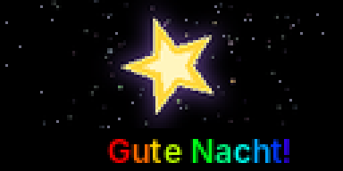
</div>

`draw(img, x, y, t)` malt das Widget an die Stelle `x, y`, jedes nur innerhalb seiner eigenen Größe.
Was zuerst gemalt wird, liegt hinten.

## ✦ Eigenes Modul bauen

Ein Modul ist eine kleine Python-Klasse: Sie bekommt die Anzeigegröße und liefert pro Frame ein Bild.
`t` ist die Zeit in Sekunden, seit das Modul aktiv ist – ideal für Animationen.

**1.** `src/ledmatrix/modules/bounce.py` anlegen:

```python
"""A dot moving from left to right."""

from PIL import Image, ImageDraw

from ledmatrix.modules.base import Module


class Bounce(Module):
    def __init__(self, width: int, height: int, color=(255, 0, 80), **kwargs) -> None:
        super().__init__(width, height, **kwargs)
        self.color = tuple(color)

    def render(self, t: float) -> Image.Image:
        img = Image.new("RGB", (self.width, self.height))
        x = int(t * 40) % self.width
        y = self.height // 2
        ImageDraw.Draw(img).ellipse((x - 3, y - 3, x + 3, y + 3), fill=self.color)
        return img
```

**2.** In `src/ledmatrix/modules/__init__.py` eintragen:

```python
from ledmatrix.modules.bounce import Bounce

REGISTRY = {
    "clock": Clock,
    "bounce": Bounce,
}
```

**3.** In deiner `config/config.yaml` ergänzen:

```yaml
  - type: bounce
    duration: 8
    color: [255, 0, 80]
```

Mit `python -m ledmatrix --preview` anschauen – fertig.

> [!TIP]
> Immer mit `self.width` und `self.height` rechnen, nie mit festen Zahlen –
> dann läuft dein Modul auf jedem Panel-Aufbau.
> `**kwargs` an `super().__init__()` weitergeben – darüber bekommt dein Modul die Sprache.

### Texte in mehreren Sprachen

Leg deine Texte in `texts` ab und hol sie mit `self.text(...)`:

```python
from PIL import Image, ImageDraw

from ledmatrix.fonts import fit_font
from ledmatrix.modules.base import Module


class Greeting(Module):
    texts = {
        "en": {"hello": "Hello!"},
        "de": {"hello": "Hallo!"},
    }

    def render(self, t: float) -> Image.Image:
        img = Image.new("RGB", (self.width, self.height))
        font = fit_font(self.text("hello"), self.width - 4, self.height - 4)
        ImageDraw.Draw(img).text((self.width / 2, self.height / 2), self.text("hello"),
                                 font=font, fill=(255, 255, 255), anchor="mm")
        return img
```

`fit_font` (aus `ledmatrix.fonts`) sucht die größte Schriftgröße, die passt – mit der mitgelieferten
Schrift [Inter](https://github.com/rsms/inter), die alle Umlaute und Akzente kann.

---

## ✦ Projektstruktur

```
Waveshare-P2.5-LED-Matrix/
├── config/
│   └── config.example.yaml     Vorlage für deine config.yaml
├── docs/                       Übersetzungen, Roadmap, Bilder
├── examples/                   Beispieldateien: star.gif, cruise_ship.png
├── src/ledmatrix/
│   ├── __main__.py             Startpunkt (python -m ledmatrix)
│   ├── colors.py               Farbpaletten
│   ├── config.py               Config einlesen und prüfen
│   ├── fonts.py                Schrift-Helfer (mitgelieferte Inter-Schrift)
│   ├── renderer.py             Ausgabe auf die LED-Panels
│   ├── scheduler.py            spielt die Module nacheinander ab
│   ├── transitions.py          Übergänge zwischen zwei Bildern (fade, fade_black)
│   ├── modules/
│   │   ├── base.py             Basisklasse für alle Module (inkl. Übersetzungen)
│   │   ├── clock.py            Uhr-Modul
│   │   ├── christmas.py        Weihnachts-Countdown
│   │   ├── countdown.py        Countdown zu einem beliebigen Datum
│   │   ├── gif.py              GIF-Player
│   │   ├── scrolltext.py       Lauftext
│   │   └── voyage.py           Reise-Countdown mit Schiff
│   ├── widgets/                Bausteine für Module
│   │   ├── base.py             Basisklasse für alle Widgets
│   │   ├── effects/            bewegte Effekte
│   │   │   ├── particles.py    Bild in Pixel zerspringen und wieder zusammensetzen
│   │   │   └── snow.py         Schneefall
│   │   ├── media/              Bilder und Animationen
│   │   │   └── gif.py          animiertes GIF oder Standbild
│   │   ├── scenery/            Hintergründe
│   │   │   ├── sky.py          Himmel mit Wolken
│   │   │   └── water.py        Wasser mit Wellen
│   │   └── text/               Text
│   │       ├── countdown.py    Tage und Zeit bis zum Ziel
│   │       └── scrolling_text.py  Lauftext
│   ├── web/                    Web-Oberfläche (optionales Extra)
│   │   ├── hub.py              gibt jedes Bild an die Panels und den Browser
│   │   ├── api.py              JSON-API und Live-Stream (FastAPI)
│   │   ├── server.py           startet den Webserver neben der Anzeige
│   │   └── static/             die Seite
│   │       ├── index.html      Aufbau der Seite
│   │       ├── style.css       Optik: helles und dunkles Design
│   │       ├── led.js          Live-Bild als leuchtende LEDs
│   │       └── app.js          Menü, Texte und Daten aus der API
│   └── assets/fonts/           Inter-Schrift und ihre Lizenz
└── pyproject.toml              Projektbeschreibung und Abhängigkeiten
```

## ✦ Hardware

- **Raspberry Pi 4** (ohne Desktop, per SSH)
- **4× Waveshare RGB-Matrix P2.5, 64×32** im 2×2-Raster → **128×64 Pixel**
- Ansteuerung über [rpi-rgb-led-matrix](https://github.com/hzeller/rpi-rgb-led-matrix), GPIO-Mapping `regular`
- Eigene Verdrahtung über die GPIO-Leiste, zwei parallele Ketten mit je zwei Panels
- Eigenes 5-V-Netzteil für die Panels (laut Waveshare bis 2,5 A pro Panel)

*Schaltplan und Klemmenplan folgen.*

## ✦ Fehlersuche

<details>
<summary><code>snd_bcm2835: found that the Pi sound module is loaded</code></summary>

<br>Der Onboard-Sound ist noch aktiv. [Schritt 2](#2--onboard-sound-abschalten) ausführen und neu starten.
</details>

<details>
<summary><code>make: No rule to make target 'build-python'</code></summary>

<br>Die Python-Anbindung von rpi-rgb-led-matrix wird seit Februar 2026 mit `pip` gebaut.
In der aktivierten venv `pip install ~/rpi-rgb-led-matrix` verwenden.
</details>

<details>
<summary><code>ModuleNotFoundError: No module named 'ledmatrix'</code> oder <code>'rgbmatrix'</code></summary>

<br>Die venv ist nicht aktiv – `source .venv/bin/activate` ausführen.
Mit `sudo` immer das Python der venv nehmen: `sudo .venv/bin/python -m ledmatrix`.
</details>

<details>
<summary><code>The web interface needs the web extra</code> oder die Seite öffnet sich nicht</summary>

<br>Das Extra installieren: `pip install -e ".[web]"`. PC oder Handy müssen im selben Netz wie der Pi sein –
nimm die IP aus `hostname -I` und den Port aus der Config (Standard 8080).
</details>

<details>
<summary>Bild doppelt, Flackern oder Panels bleiben dunkel</summary>

<br>Prüfen, ob `chain_length` und `parallel` zu den wirklich angeschlossenen Panels passen.
</details>

<details>
<summary>Falsche Farben</summary>

<br>Eine andere `rgb_sequence` probieren (z. B. `RBG`, `GRB`). Roter Text muss rot sein, grüner grün.
</details>

<details>
<summary>Eine Kette zeigt nur einzelne Zeilen (Streifen)</summary>

<br>Auf dieser Kette fehlt eine Adressleitung (A, B, C oder D) – Verdrahtung prüfen.
</details>

## ✦ Ideen & Mitmachen

Dieses Projekt lebt von Ideen – **deine sind herzlich willkommen!**

- 💡 **Eine Idee oder ein Wunsch?** [Eröffne ein Issue](https://github.com/gerry-git-ops/Waveshare-P2.5-LED-Matrix/issues/new) und beschreib sie.
- 🧩 **Du brauchst ein spezielles Modul?** Beschreib, was es zeigen soll – ich baue gern Module auf Wunsch.
- 🐞 **Einen Fehler gefunden?** Eröffne ein Issue: was du gemacht hast, was du erwartet hast und wenn möglich ein Foto der Panels.
- 🔧 **Selbst etwas gebaut?** Ein neues Modul, Widget oder eine Sprache – Pull Requests sind willkommen.

## ✦ Lizenz

Dieses Projekt steht unter der [GNU General Public License v3.0](../LICENSE).

Es baut auf [rpi-rgb-led-matrix](https://github.com/hzeller/rpi-rgb-led-matrix) von Henner Zeller (GPL) auf.
Die mitgelieferte Schrift [Inter](https://github.com/rsms/inter) steht unter der
[SIL Open Font License 1.1](../src/ledmatrix/assets/fonts/OFL.txt).

## ✦ Roadmap

Was geplant ist und was schon läuft: [ROADMAP](roadmap.de.md)

---

<div align="center">
<sub>Ein Projekt zum Lernen, Bauen und Leuchten.</sub>
</div>
